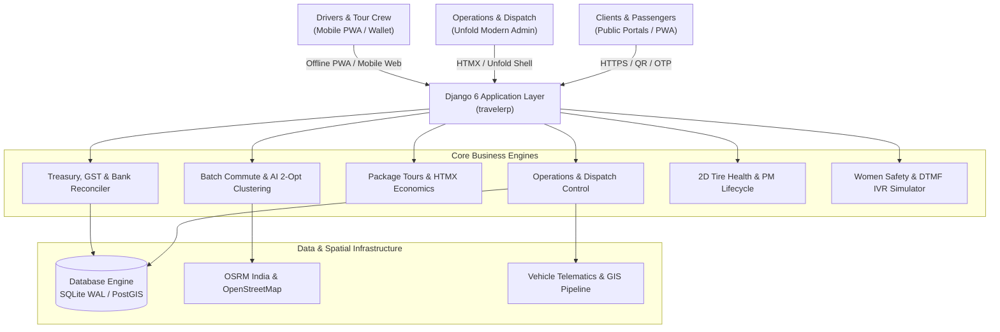

# 🌐 SIVA GAYATHRI TOURS & TRAVELS — TRAVELERP
## Chapter 01: System Overview & Master Documentation Index

---

### 1. Executive Summary

**Siva Gayathri Tours & Travels / TravelERP** is an enterprise-grade, omnichannel Travel Operations and Fleet Management ERP engineered for high-scale fleet dispatch, corporate employee transit, student industrial visits (IV), pilgrimage package tours, and end-to-end transport accounting.

Operating across Tamil Nadu, Karnataka, Kerala, Andhra Pradesh, and All-India tour circuits, the platform manages **300+ vehicles** (Sedans, Innova MPVs, Tempo Travellers, Mini Buses, and 54-Seater Luxury Pushback Coaches).

---

### 2. Modern Technology Stack

| Tier | Technologies / Engines | Purpose |
| :--- | :--- | :--- |
| **Backend Core** | Python 3.12, Django 6.0, Django REST Framework | Core business logic, ORM, security, session management |
| **Theme & UI Shell** | Django Unfold, Tailwind CSS, Heroicons, FontAwesome 6 | Enterprise navigation, command palette, high-contrast layouts |
| **Reactivity** | HTMX 1.9, Vanilla JavaScript (ES6+), Alpine.js | Reactive sub-second UI updates without heavy SPA build overhead |
| **Database & GIS** | SQLite 3 (Production-optimized WAL) / PostgreSQL + PostGIS | Geometries, telemetry logging, partitioning, multi-tenant tables |
| **Cartography & Maps**| Leaflet.js 1.9, OpenStreetMap, OSRM India Routing Engine | Live fleet radars, passenger bus tracking, TSP route optimization |
| **Mobile & PWA** | Web App Manifest, Service Workers, Offline Caching | Driver PWA, QR Boarding Scanner, Mobile Passenger Web Pass |
| **AI & Telephony** | Groq LLM (TARA AI Copilot), Twilio / Exotel DTMF IVR Webhook | Natural language fleet copilot, automated night shift safety calls |
| **Aesthetics** | High-Contrast Sunlight Light Mode + Dark Mode Synchronization | Daylight visibility for field managers, persistent `localStorage` sync |

---

### 3. Master Documentation Directory

This documentation suite reflects the current state of the application:

```text
documentation/
├── 01_SYSTEM_OVERVIEW_AND_INDEX.md          # Platform overview, tech stack, and documentation index
├── 02_OPERATIONAL_STUDIOS_AND_CONSOLES.md   # 10+ custom studios, visual boards, and control rooms
├── 03_COMMUTE_AUTOMATION_AND_ENTERPRISE.md  # 300+ vehicle commute, AI clustering, TSP 2-Opt & safety
├── 04_PACKAGE_TOURS_AND_EXPEDITIONS.md      # 24 ModelAdmins, HTMX decks, unit economics, IV protocols
├── 05_FINANCE_TREASURY_AND_BILLING.md       # GST B2B invoicing, Dynamic UPI, bank reconciliation, bata
├── 06_FLEET_MAINTENANCE_AND_COMPLIANCE.md   # 2D Tire Health Studio, 2D Damage Marker, statutory compliance
├── 07_LIGHT_MODE_AND_AESTHETICS_SYSTEM.md   # High-contrast daylight tokens, anti-FOUC, design guidelines
├── 08_API_AND_INTEGRATION_REFERENCE.md      # REST APIs, HTMX endpoints, WhatsApp Cloud, Arattai, OSRM
├── 09_AUDIT_INTEGRITY_AND_DEDUPLICATION.md  # Deduplication report, zero model collision, test inventory
└── 10_FUTURE_PHASES_ROADMAP.md              # Strategic roadmap for Phases 8, 9, 10, 11, and 12
```

---

### 4. High-Level System Architecture



---

### 5. Application Portfolio Summary

The workspace is organized into **20 focused Django apps**, ensuring clean separation of concerns and maintainability:

1. `core`: Master entities (Vehicles, Drivers, Clients, Suppliers, Vehicle Types, Rate Cards).
2. `operations`: Bookings, Trips, Trip Sheets, Dispatch Recommendations, Telematics Tracking.
3. `fleet_commute`: School & Corporate shift dispatcher, AI clustering, live tracking, women safety.
4. `fleet_contracts`: Institutional transport agreements, dedicated fleet rosters, monthly invoicing, SLA penalties.
5. `packages`: Tour packages, templates, seasonal rates, hotel allotments, addons, B2B margins.
6. `package_tours`: Unfold role-based proxies for Tour Departure Batches, College IVs, and Manifests.
7. `finance`: Ledger accounts, transactions, petty cash registers, driver allowances (Bata).
8. `finance_fleet`: Fleet profitability radar, Cost-Per-KM (CPK) analytics, vehicle P&L.
9. `finance_treasury`: Corporate GST invoicing, NIC E-Way bills, payment gateway tracking.
10. `maintenance`: Work orders, PM schedules, 2D vehicle damage marker, 2D tire studio.
11. `maintenance_compliance`: Statutory insurance, fitness certificates, permits, emission tokens.
12. `crm`: Inquiry pipeline, drag-and-drop Kanban board, TAT analytics, objection logs.
13. `marketing`: Omnichannel lead campaigns, upsell recommendations, social webhooks.
14. `suppliers`: DMC vendor network, contracted tariffs, purchase orders, commissions.
15. `customer_portal`: Self-service booking portal, voucher downloads, invoice receipts.
16. `driver_portal`: Driver mobile trip dashboard, offline PWA, digital manifest boarding.
17. `digital_services`: Dynamic UPI QR generator, payment links, gateway webhooks.
18. `enterprise_governance`: Audit logging, supplier governance, corporate compliance.
19. `analytics`: DMC executive analytics, route performance, revenue yield.
20. `integrations`: Meta WhatsApp Cloud, Arattai webhook, Google Sheets, OSRM routing.
