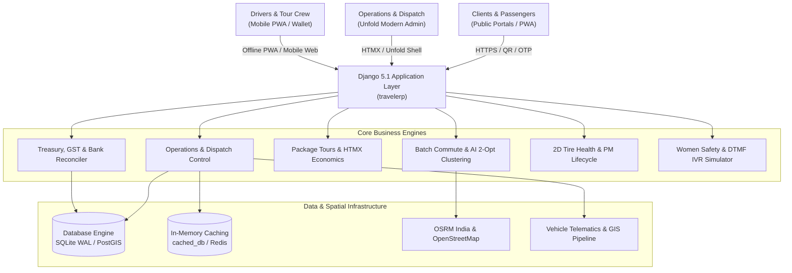

# 🌐 SIVA GAYATHRI TOURS & TRAVELS — TRAVELERP
## Chapter 01: System Overview & Master Documentation Index

---

### 1. Executive Summary

**Siva Gayathri Tours & Travels / TravelERP** is an enterprise-grade, omnichannel Travel Operations and Fleet Management ERP engineered for high-scale fleet dispatch, corporate employee transit, student industrial visits (IV), pilgrimage package tours, and end-to-end transport accounting.

Operating across Tamil Nadu, Karnataka, Kerala, Andhra Pradesh, and All-India tour circuits, the platform manages **300+ vehicles** (Sedans, Innova MPVs, Tempo Travellers, Mini Buses, and 54-Seater Luxury Pushback Coaches).

---

### 2. Modern Technology Stack

| Tier | Technologies / Engines | Purpose |
| :--- | :--- | :--- |
| **Backend Core** | Python 3.12, Django 5.1 LTS, Django Channels 4.3 / Daphne ASGI | Core business logic, ORM, WebSockets, security, session management |
| **In-Memory & Session**| `cached_db` Session Backend, django-redis 6.0, channels-redis 4.3 | Sub-millisecond session lookups, zero DB hits on auth requests, Redis layers |
| **Static & Fonts** | WhiteNoise 6.9, 100% Local WOFF2 Fonts (Zero External CDN) | 6 self-hosted font families, local Leaflet, FontAwesome, Chart.js, HTMX |
| **Theme & UI Shell** | Django Unfold 0.40, Custom Unfold Tokens, Tailwind CSS | Enterprise navigation, command palette, high-contrast daylight layouts |
| **Reactivity** | HTMX 1.21, Vanilla JavaScript (ES6+), Alpine.js 3.14 | Reactive sub-second UI updates without heavy SPA build overhead |
| **Database & GIS** | SQLite 3 WAL Mode (Dev) / PostgreSQL 15 + PostGIS (Prod) | Geometries, vector embeddings for package search, concurrent non-blocking reads |
| **Cartography & Maps**| Leaflet.js 1.9, OpenStreetMap, OSRM India Routing Engine | Live fleet radars, passenger bus tracking, TSP route optimization |
| **Mobile & PWA** | Web App Manifest, Service Workers v4, Offline Caching | Driver PWA, QR Boarding Scanner, Mobile Passenger Web Pass |
| **AI & Telephony** | Groq Cloud LLaMA 3.3 / Qwen (Rathasārathi AI Copilot) | Natural language fleet copilot, semantic tour search, WhatsApp pitches |
| **Aesthetics** | High-Contrast Sunlight Light Mode + Dark Mode Synchronization | Daylight visibility for field managers, persistent `localStorage` sync |

---

### 3. Master Documentation Directory

This documentation suite reflects the current state of the application:

```text
documentation/
├── 01_SYSTEM_OVERVIEW_AND_INDEX.md          # Platform overview, tech stack, and documentation index
├── 02_OPERATIONAL_STUDIOS_AND_CONSOLES.md   # 22+ custom studios, visual boards, and control rooms
├── 03_COMMUTE_AUTOMATION_AND_ENTERPRISE.md  # 300+ vehicle commute, AI clustering, TSP 2-Opt & safety
├── 04_PACKAGE_TOURS_AND_EXPEDITIONS.md      # 24 ModelAdmins, HTMX decks, unit economics, IV protocols
├── 05_FINANCE_TREASURY_AND_BILLING.md       # GST B2B invoicing, Dynamic UPI, bank reconciliation, bata
├── 06_FLEET_MAINTENANCE_AND_COMPLIANCE.md   # 2D Tire Health Studio, 2D Damage Marker, statutory compliance
├── 07_LIGHT_MODE_AND_AESTHETICS_SYSTEM.md   # High-contrast daylight tokens, zero-CDN local assets, anti-FOUC
├── 08_API_AND_INTEGRATION_REFERENCE.md      # REST APIs, HTMX endpoints, WhatsApp Cloud, Arattai, OSRM
├── 09_AUDIT_INTEGRITY_AND_DEDUPLICATION.md  # Deduplication report, zero model collision, test inventory
├── 10_FUTURE_PHASES_ROADMAP.md              # Strategic roadmap for Phases 8, 9, 10, 11, and 12
├── 11_PRODUCTION_DEPLOYMENT_AND_HARDENING.md # Production Docker stack, Nginx SSL, Daphne ASGI, backups
└── 12_PERFORMANCE_AND_ZERO_CDN_ARCHITECTURE.md # Zero-CDN benchmarks, 42.43ms latency, and query optimizations
```

---

### 4. High-Level System Architecture



---

### 5. Application Portfolio Summary

The workspace is organized into **28 focused Django applications**, ensuring clean separation of concerns and maintainability:

1. `core`: Master entities (Vehicles, Drivers, Clients, Suppliers, Vehicle Types, Rate Cards, Regional Hub Depots).
2. `core_partners`: B2B travel partners, agent commission structures, white-label agencies.
3. `core_crew`: Crew scheduling, roster rosters, cleaner, and helper assignments.
4. `operations`: Bookings, Trips, Trip Sheets, Dispatch Studios, Telematics, Breakdown SOS Relief.
5. `dashboard`: Executive KPI aggregations, revenue trends, fleet readiness summaries.
6. `fleet_commute`: School & Corporate shift dispatcher, AI clustering, live tracking, women safety.
7. `fleet_contracts`: Institutional transport agreements, dedicated fleet rosters, monthly invoicing, SLA penalties.
8. `packages`: Tour packages, templates, seasonal rates, hotel allotments, addons, B2B margins.
9. `package_tours`: Group Tour Departure Batches, College IVs, and Student Manifests.
10. `finance`: Ledger accounts, transactions, petty cash registers, driver allowances (Bata).
11. `finance_fleet`: Fleet profitability radar, Cost-Per-KM (CPK) analytics, vehicle P&L.
12. `finance_payroll`: Chauffeur and operational staff monthly payroll, deductions, PF, ESIC.
13. `finance_treasury`: Corporate GST invoicing, NIC E-Way bills, payment gateway tracking.
14. `statements`: High-density landscape multi-page PDF CAB statements & Excel rosters.
15. `maintenance`: Work orders, PM schedules, 2D vehicle damage marker, 2D tire studio.
16. `maintenance_compliance`: Statutory insurance, fitness certificates, permits, emission tokens.
17. `crm`: Inquiry pipeline, drag-and-drop Kanban board, TAT analytics, objection logs.
18. `marketing`: Omnichannel lead campaigns, upsell recommendations, social webhooks.
19. `suppliers`: DMC vendor network, contracted tariffs, purchase orders, commissions.
20. `customer_portal`: Public customer landing page, tour package catalog, vehicle showcase, self-service booking.
21. `driver_portal`: Chauffeur mobile PWA, vehicle handover digital twin, offline duty lifecycle.
22. `documents`: Document repository, compliance papers, driver licenses, KYC uploads.
23. `digital_services`: Dynamic UPI QR generator, payment links, gateway webhooks.
24. `enterprise_governance`: Audit logging, supplier governance, corporate compliance.
25. `audit`: Audit trail logs, entity change history, deduplication tracking.
26. `analytics`: DMC executive analytics, route performance, revenue yield.
27. `payments_gateway`: Payment gateway integrations, Razorpay webhooks, ledger settlement.
28. `integrations`: Meta WhatsApp Cloud, Arattai webhook, Google Sheets, OSRM routing.
