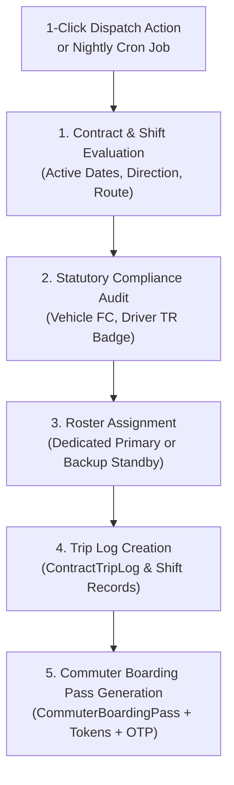

# 🚌 SIVA GAYATHRI TOURS & TRAVELS — TRAVELERP
## Chapter 03: Commute Automation & Enterprise Contract Roster

---

### 1. Overview & Scale

The `fleet_commute` and `fleet_contracts` modules manage continuous, long-term transport contracts for:
- **Corporate IT Parks & SEZs**: Amazon OMR IT SEZ, Cognizant Tech Park, PayPal India, HCL Technologies, Bosch Tech Park.
- **Educational Institutions**: Loyola College, SRM University, Engineering Campus Shuttles.
- **Manufacturing Facilities**: Renault Nissan Automotive India, BHEL.

With **300+ dedicated vehicles** operating 3 shifts per day (Morning Inward, Afternoon Rotation, Night Outward), automation is critical for zero-lag dispatch and statutory compliance.

---

### 2. Automated Daily Roster Dispatch Engine

The batch engine (`fleet_commute.roster_dispatch_engine.RosterDispatchEngine`) executes a 4-tier provisioning pipeline:

#### Key Rules:
1. **Statutory Driver License Validation**: The assigned driver must possess a valid Commercial TR (Transport) endorsement. If expired, the engine auto-assigns an approved Standby Captain and flags the dispatcher.
2. **Vehicle Fitness Certificate (FC) Check**: Ensures the vehicle's RTO fitness has not lapsed.
3. **Dedicated Contract Roster**: Uses `ContractFleetRoster` allocations, keeping specific vehicles mapped to contract routes for passenger familiarity and punctuality.

---

### 3. AI Route Clustering & 2-Opt TSP Waypoint Optimization

When commuter rosters fluctuate due to shift changes or new employee onboarding:
1. **Spatial Density Clustering**: Commuters are clustered based on geographical proximity of pickup nodes using Haversine distance thresholding.
2. **Capacity Best-Fit Matching**:
   - 1 – 4 Commuters ➔ Sedan / Compact AC
   - 5 – 7 Commuters ➔ Toyota Innova MPV
   - 8 – 14 Commuters ➔ Tempo Traveller (12/14-Seater)
   - 15 – 35 Commuters ➔ Mini Bus (25/32-Seater)
   - 36 – 54 Commuters ➔ Luxury Pushback Coach (45/54-Seater)
3. **TSP 2-Opt Waypoint Sequencing**: Orders pickup nodes to minimize circuit distance, reduce travel duration, and calculate estimated CO2 kilograms avoided.

---

### 4. Zero-Login Mobile Web Boarding Pass & Real-Time Tracking

- **Commuter Boarding Pass URL**: `/commute/pass/<pass_token>/`
  - Zero-login mobile pass accessible to employees on their smartphones.
  - Displays unique 4-digit boarding OTP, QR verification barcode, assigned bus number, driver photo, and route sequence.
- **Parent & Employee Real-Time Bus Tracker**: `/commute/track/<pass_token>/`
  - High-performance Leaflet.js radar powered by OpenStreetMap tiles.
  - 5-second asynchronous telematics polling (`/commute/api/track/<pass_token>/live/`).
  - Proximity status banner:
    - *Scheduled* (Departure at X time)
    - *En Route* (Bus Approaching, ~X mins)
    - *Completed* (Trip concluded)
  - Driver direct contact card with 1-tap call button.
  - Emergency Transport Helpdesk banner (1800-425-9999).

---

### 5. Women Safety & Statutory Night Shift Guardrails

Complying with Tamil Nadu and Indian Labour Regulations for female employees working night shifts (8:00 PM – 6:00 AM):

1. **Isolated Last Drop Detection**:
   - If a female commuter is the final drop on a night shift route, she is marked with an `⚠️ Isolated Last Drop` alert.
2. **Commute Buddy Matching**:
   - The system pairs isolated commuters with an approved commute buddy residing within a 2-km radius.
3. **Mandatory Security Escort**:
   - Vehicles with isolated drops automatically require a certified security escort guard. A pill alert displays on the dispatcher board: `🚨 MANDATORY SECURITY ESCORT REQUIRED`.
4. **Outbound Telephony IVR Simulator**:
   - Automated outbound call triggered upon employee drop (`/commute/api/ivr/simulate-call/`).
   - Telecom DTMF Webhook (`/commute/api/ivr/webhook/`):
     - **Digit 1**: *Confirmed Safe Home* ➔ Boarding pass marked `Verified Safe`.
     - **Digit 2**: *Panic SOS* ➔ Instant alert dispatched to Transport Command Center & Police Helpline.

---

### 6. Corporate SLA Performance & Penalty Deductions Studio

- **Contractual Thresholds**:
  - Punctuality SLA: Departure / Arrival within 15 minutes of scheduled time.
  - Delay Penalty: Automatic contractual deduction (e.g. ₹500 – ₹2,000 per delayed trip).
  - Speed Violations: Fleet GPS speed limiter monitoring (breach > 50 km/h or school bus > 40 km/h).
- **Monthly Invoicing Integration**:
  - Infractions recorded in `ContractSLAPenalty`.
  - Automatically netted against gross monthly billing in `ContractMonthlyInvoice`.
- **Executive Waiver Console**:
  - Allows operations leadership to waive penalties caused by client delays, police diversions, or extreme weather, requiring a signed waiver audit reason.
