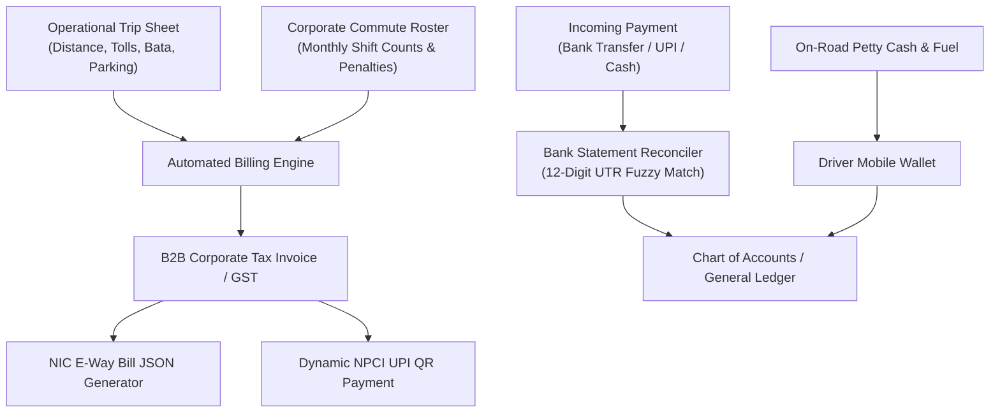

# 💳 SIVA GAYATHRI TOURS & TRAVELS — TRAVELERP
## Chapter 05: Finance, Treasury & Commercial Billing

---

### 1. Financial Architecture Overview

TravelERP incorporates a robust double-entry financial accounting core designed specifically for transport and tour operators. It eliminates the need for separate standalone accounting software by unifying operational trip sheets directly with the General Ledger.

---

### 2. Corporate GST B2B Invoicing & NIC E-Way Bill Studio

- **URL**: `http://127.0.0.1:8000/admin/finance/gst-studio/`
- **Regulatory Compliance**:
  - Intra-state passenger transit (Tamil Nadu to Tamil Nadu): 2.5% CGST + 2.5% SGST (5% without Input Tax Credit) or 6% + 6% (12% with ITC).
  - Inter-state luxury tour transit (Tamil Nadu to Karnataka/Kerala): 5% / 12% IGST.
- **NIC E-Way Bill Integration**:
  - Automatically formats commercial fleet movements exceeding statutory thresholds into official National Informatics Centre (NIC) E-Way Bill JSON (`/api/finance/invoice/<id>/eway-json/`).
  - Contains mandatory HSN/SAC codes (`996412` for local passenger transport, `996414` for intercity coach charter).
- **1-Click WhatsApp Invoice Dispatch**:
  - Instant dispatch of branded PDF invoice and payment link directly to client accounts managers via WhatsApp Cloud API.

---

### 3. Dynamic NPCI UPI QR & Instant Payment Gateway

- **URL**: `http://127.0.0.1:8000/admin/finance/payment-studio/`
- **Core Functionality**:
  - Dynamic QR Generator compliant with NPCI UPI 2.0 specifications (`upi://pay?pa=sivagayathiritravels@hdfcbank&pn=Siva%20Gayathiri%20Tours&am=...&tr=...`).
  - Unique transaction reference (TR) generated per invoice or booking, enabling zero-confusion reconciliation.
  - Webhook simulation and payment link SMS generation (`/payments/link/<token>/`).

---

### 4. Automated Bank Statement CSV Reconciler & UTR Matching

- **URL**: `http://127.0.0.1:8000/admin/finance/bank-reconciliation/`
- **Algorithmic UTR Matching**:
  - Ingests standard bank CSV statements (HDFC, ICICI, SBI, Axis, Kotak).
  - Extracts 12-digit Unique Transaction Reference (UTR) numbers using regex (`\b[0-9]{12}\b` / `CMS[0-9]{9,}`).
  - Cross-references UTR numbers against unpaid invoices, customer deposits, and driver wallet top-ups.
  - Three Match Confidence Tiers:
    - 🟢 **100% Exact Match**: UTR and exact transaction amount match an unpaid invoice. Auto-reconciled with 1 click.
    - 🟡 **Fuzzy Match (>= 80%)**: Amount matches with partial party name match. Suggested for operator approval.
    - 🔴 **Unmatched**: Flagged for manual investigation.

---

### 5. Petty Cash Float Register & Driver Mobile Wallet

- **Petty Cash Studio**: `/admin/finance/petty-cash-studio/`
  - Central cash register for fleet managers and custodians.
  - Records daily opening balances, cash allocations to drivers for multi-day trips, and cash returns upon trip closure.
- **Driver Mobile Cash Wallet**: `/driver/wallet/`
  - Designed for drivers and tour managers operating on the road.
  - Real-time logging of on-trip cash outlays:
    - *Diesel Fuel* (Volume in liters + rate per liter)
    - *Highway Tolls* (Fastag offline cash receipts)
    - *State Border Entry Tax Permits* (Tamil Nadu, Karnataka, Kerala, Andhra Pradesh)
    - *Driver Daily Allowance (Bata)*
    - *Parking & Cleanliness*
  - Receipt photo upload with live remaining cash float balance.

---

### 6. Driver Allowance (Bata) Calculation Engine

- **API Endpoint**: `/api/trip/<trip_id>/bata/calculate/`
- **Multi-Tier Statutory Bata Formulas**:
  1. **Standard Day Bata**: Single-day intercity travel (e.g. ₹400 for Sedan, ₹500 for Innova, ₹700 for Coach).
  2. **Night Shift / Night Halt Bata**: Travel or duty extending between 10:00 PM and 6:00 AM (additional ₹300 per night).
  3. **Ghat Road & Hill Station Allowance**: Routes involving Nilgiris/Ooty, Kodaikanal, Munnar, or Yercaud ghat roads require extra hill allowance (₹350 per day) due to demanding driving conditions.
  4. **Multi-Day Tour Bata**: Automatically calculated by multiplying tour calendar days with the vehicle tier daily bata rate.
