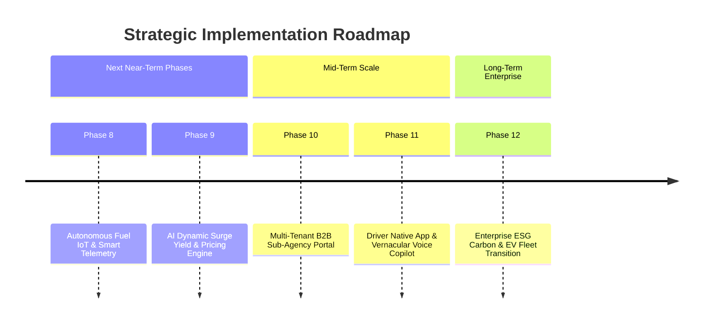

# 🚀 SIVA GAYATHRI TOURS & TRAVELS — TRAVELERP
## Chapter 10: Strategic Roadmap — Future Phases for Implementation

---

### 1. Executive Roadmap Overview

Having completed the core operations, corporate commute automation, financial reconciliation, and package tour modernization through Phase 7, the following strategic phases represent high-impact, enterprise-grade capabilities ready for implementation:

---

### 2. Phase 8: Autonomous Fleet Fuel IoT & Smart Sensor Telemetry

#### Business Objective:
Fuel constitutes **38%–45%** of operational expenditure in commercial bus and cab fleets. Phase 8 eliminates fuel pilferage, unauthorized fuel drops, and false fuel slip expense claims.

#### Key Features to Implement:
1. **CAN-bus / OBD-II Real-Time Fuel Telemetry**:
   - Ingests direct tank float sensor readings and engine fuel injection flow rates every 30 seconds.
   - Plots live fuel level curve against distance traveled.
2. **Instant Fuel Drop Theft Detection**:
   - If fuel tank level drops by > 8 Liters within 3 minutes while the engine is stationary, an immediate `🚨 FUEL THEFT DETECTED` alarm triggers on the operations radar and SMS alerts the fleet director.
3. **Automated Petrol Bunk Slip OCR**:
   - Driver snaps a photo of the IndianOil / HP / Bharat Petroleum printed receipt in their Mobile Wallet.
   - On-device Tesseract OCR extracts Bunk Name, Liters Pumped, Rate/Liter, and Total Amount, validating it against the fuel level spike detected by the tank sensor.
4. **Mileage Anomaly & Engine Idling Sentry**:
   - Flags drivers whose vehicle mileage drops below target benchmarks (e.g. Innova < 12.5 km/l or Volvo Coach < 3.8 km/l).
   - Monitors AC engine idling during long halts, calculating wasted fuel costs.

---

### 3. Phase 9: AI Dynamic Surge Yield & Multi-Modal Pricing Engine

#### Business Objective:
Maximizes fleet revenue per available seat-kilometer (RASK) by replacing static rate cards with an algorithmic pricing engine that dynamically adjusts prices based on regional demand, festivals, and vehicle availability.

#### Key Features to Implement:
1. **Tamil Nadu & South India Festival Surcharge Engine**:
   - Auto-applies dynamic demand multipliers during peak pilgrimage and holiday windows:
     - *Diwali & Pongal exodus* (1.35x – 1.6x multiplier)
     - *Sabarimala Mandala Pooja pilgrimage season (Nov – Jan)* (1.4x for Tempo & Mini Bus)
     - *Summer Ooty / Kodaikanal season (Apr – May)* (1.3x for AC Coaches)
2. **Fleet Utilization & Supply Scarcity Multiplier**:
   - When active fleet utilization exceeds 85%, automated quotation proposals automatically adjust margins upward by +8% to +15%.
3. **Competitor Tariff Intelligence Ingestion**:
   - Automated scraper monitoring leading intercity and tour operators in Chennai and Bangalore to keep Siva Gayathri rates competitive while maximizing profit margins.
4. **Automated B2B Lead Quotation Bot**:
   - Analyzes incoming corporate queries (Group Size, Circuit, Duration, Dates) and generates an optimized proforma quote within 90 seconds.

---

### 4. Phase 10: Multi-Tenant White-Label Franchise & Sub-Agency B2B Portal

#### Business Objective:
Expands Siva Gayathri's distribution network by allowing independent travel agents, corporate travel desks, and college unions to book fleet inventory under their own brand.

#### Key Features to Implement:
1. **White-Label Agency Branding**:
   - Sub-agencies receive customized portals (`agency.sivagayathiritravels.com`) featuring their logo, contact details, and brand colors.
   - Customer-facing booking vouchers and tour itineraries generate with the sub-agency's branding while operational dispatch remains centralized.
2. **Digital Sub-Agent Prepaid Wallet & Credit Limit**:
   - Sub-agents maintain a prepaid float balance or an approved 15-day credit line (`B2BCreditLimit`).
   - Bookings auto-deduct agent net rates from the wallet balance.
3. **Tiered Markup Commission Management**:
   - Configurable margin rules per agent tier (Gold, Silver, Platinum):
     - Agent can set their custom customer markup (e.g. Net Rate + 12% profit) while TravelERP collects the net wholesale tariff.

---

### 5. Phase 11: Real-Time Mobile Driver Native App & Vernacular Voice Copilot

#### Business Objective:
Empowers drivers on the ground with an easy-to-use native mobile application featuring regional language voice prompts, ensuring drivers never miss a pickup stop or safety protocol.

#### Key Features to Implement:
1. **Vernacular Voice Guidance**:
   - Audio alerts in **Tamil, Telugu, Kannada, and Hindi**:
     - *"அடுத்த நிறுத்தம்: Main Campus Stop. 2 பயணிகள் ஏற வேண்டும்."*
     - *"Next Stop: Main Campus Stop. 2 Passengers boarding."*
2. **Turn-by-Turn Low-Bandwidth GPS Navigation**:
   - Integrated offline-capable navigation pre-loaded with optimal bus routes and commercial vehicle bridge clearance limits.
3. **Geofenced Automated Passenger Boarding & Drop Detection**:
   - As the bus approaches within 50 meters of a commuter stop, the app prompts the driver with passenger names and handles boarding with zero manual taps.
4. **Emergency Audio SOS Hotline**:
   - 1-Press SOS button opens a direct, 2-way recorded audio channel to the Siva Gayathri Central Control Room.

---

### 6. Phase 12: Enterprise ESG Carbon Accounting & EV Fleet Transition Simulator

#### Business Objective:
Enables multinational corporate clients (Amazon, Cognizant, TCS, PayPal) to satisfy mandatory ESG (Environmental, Social, and Governance) reporting requirements, positioning Siva Gayathri as the premier sustainable transport partner in South India.

#### Key Features to Implement:
1. **Automated Scope 1 & Scope 3 Carbon Emission Reporting**:
   - Calculates exact greenhouse gas emissions ($CO_2$, $NO_x$, Particulate Matter) per trip using DEFRA and Indian Bureau of Energy Efficiency factors.
   - Compares shared group shuttle transit against single-occupancy private cars, generating verified `Net CO2 Avoidance Certificates` for clients.
2. **Corporate Monthly ESG Scorecard Generator**:
   - Automated monthly PDF export summarizing:
     - Total Green Passenger Kilometers traveled.
     - Metric Tons of $CO_2$ avoided.
     - Female Night Commuter Safe Transport Index (100% Escort Compliance).
3. **Electric Bus (EV) Fleet Transition Feasibility Simulator**:
   - Route simulation modeling battery range degradation on ghat roads and highway routes.
   - Charging schedule recommendations based on depot layovers and off-peak electricity tariffs.

---

### 7. Implementation Recommendation Matrix

| Phase | Technical Complexity | Business ROI | Time to Deploy | Recommended Priority |
| :--- | :---: | :---: | :---: | :---: |
| **Phase 8: Fuel IoT & Anti-Theft** | Moderate | 🟢 Immediate Cost Savings (₹1.5L+/mo) | 1–2 Weeks | ⭐ **Top Priority** |
| **Phase 9: AI Dynamic Pricing** | Low–Moderate | 🟢 Revenue Boost (+12%–18%) | 1 Week | ⭐ **High Priority** |
| **Phase 10: B2B Sub-Agency Portal**| Moderate | 🟢 Volume Multiplier (3x Bookings) | 2 Weeks | ⭐ **High Priority** |
| **Phase 11: Driver Voice Copilot** | Moderate | 🟡 Operational Efficiency | 2 Weeks | Standard |
| **Phase 12: ESG Carbon Accounting**| Low | 🟢 Wins MNC Enterprise RFPs | 1 Week | Fast Win |
