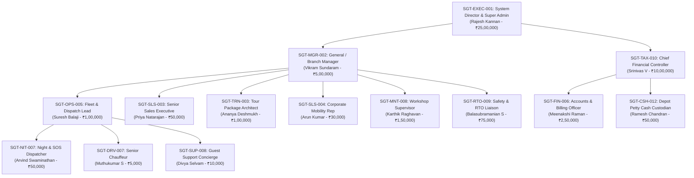

# 📘 TravelERP Enterprise Role Manual & Persona Operations Guide

Welcome to the **Sivagayathiri Travels & TravelERP** Enterprise Role Operations Manual. This guide provides a comprehensive breakdown of each staff persona, their daily operational workflows, access permissions, financial ceilings, accessible studios, and cross-department collaboration rules.

---

## 🏛️ Executive Summary & Role Hierarchy

---

## 1. Executive Leadership & Governance

### 👑 SGT-EXEC-001 | Rajesh Kannan
* **Title:** System Director / Super Admin & Managing Director
* **Department:** Executive Management
* **Base Depot:** Chennai Central HQ (Global Cross-Depot Authority)
* **Approval Ceiling:** ₹25,00,000
* **System Username:** `admin_rajesh`
* **Direct Switch Link:** [`/auth/switch-persona/admin_rajesh/`](http://127.0.0.1:8000/auth/switch-persona/admin_rajesh/)

#### Daily Workflow:
1. **Morning Executive Briefing:** Opens the [Main Executive Dashboard](http://127.0.0.1:8000/) to review enterprise KPIs—Active fleet on road, monthly Gross Revenue, Bank Liquidity, and open SOS alerts.
2. **High-Value Deal Authorizations:** Reviews tour proposals and corporate contracts exceeding ₹5,00,000 or customer discount waivers exceeding 15%.
3. **Staff Governance & RBAC Auditing:** Navigates to [Staff Roles & Permissions Matrix](http://127.0.0.1:8000/staff/roles-matrix/) to adjust employee approval ceilings, reassign depot branches, or provision new team members.
4. **Capital Expenditure (CapEx) Sign-Offs:** Authorizes new vehicle asset purchases, depot lease renewals, and major engine overhaul work orders.

#### Primary URLs & Consoles:
* Executive Master Dashboard: [`/`](http://127.0.0.1:8000/)
* Django Unfold Enterprise Admin: [`/admin/`](http://127.0.0.1:8000/admin/)
* Staff Roles & Capability Matrix: [`/staff/roles-matrix/`](http://127.0.0.1:8000/staff/roles-matrix/)
* Profit & Loss Analytics: [`/analytics/pnl/`](http://127.0.0.1:8000/analytics/pnl/)

---

### 🏢 SGT-MGR-002 | Vikram Sundaram
* **Title:** General / Branch Manager
* **Department:** Regional Operations
* **Base Depot:** Coimbatore Hub
* **Approval Ceiling:** ₹5,00,000
* **System Username:** `mgr_vikram`
* **Direct Switch Link:** [`/auth/switch-persona/mgr_vikram/`](http://127.0.0.1:8000/auth/switch-persona/mgr_vikram/)

#### Daily Workflow:
1. **Regional Depot Health Check:** Inspects vehicle readiness across Coimbatore, Pollachi, and Nilgiris corridors.
2. **Discount & Margin Approvals:** Evaluates quotations submitted by sales reps that offer customer discounts between 5% and 15%.
3. **Fleet Relocation Approvals:** Authorizes deadhead inter-depot vehicle transfers (e.g., shifting 3 Innova Crystas from Madurai to Coimbatore for an upcoming wedding convention).
4. **Driver Disciplinary & SLA Reviews:** Investigates driver overspeeding violations, customer complaints, or corporate commute SLA delay penalties.

#### Primary URLs & Consoles:
* Branch Fleet Operations Cockpit: [`/operations/fleet-radar/`](http://127.0.0.1:8000/operations/fleet-radar/)
* Vehicle Roster & Specifications: [`/core/vehicles/`](http://127.0.0.1:8000/core/vehicles/)
* Quotations Review Desk: [`/crm/queries/`](http://127.0.0.1:8000/crm/queries/)
* Financial Ledgers: [`/finance/`](http://127.0.0.1:8000/finance/)

---

## 2. Commercial, Tour Design & B2B Sales

### 🗺️ SGT-TRN-003 | Ananya Deshmukh
* **Title:** Senior Tour Designer & Package Architect
* **Department:** Commercial & Tour Planning
* **Base Depot:** Chennai Central HQ
* **Approval Ceiling:** ₹1,00,000
* **System Username:** `tour_ananya`
* **Direct Switch Link:** [`/auth/switch-persona/tour_ananya/`](http://127.0.0.1:8000/auth/switch-persona/tour_ananya/)

#### Daily Workflow:
1. **Itinerary Engineering:** Builds authentic day-by-day itineraries (Ooty, Kodaikanal, Munnar, Mysore, Coorg, Rameshwaram, Wayanad) in the [Tour Package Builder](http://127.0.0.1:8000/packages/).
2. **Hotel Allotments & Meal Plans:** Allocates contracted resort rooms (EP / CP / MAP / AP) to seasonal packages and configures peak-season surge rules.
3. **Luxury Proposal PDF Publishing:** Generates multi-tier brochures using the luxury 5-page PDF engine ([Option B](http://127.0.0.1:8000/crm/quotations/1/preview/)).
4. **College Industrial Visit (IV) Manifest Design:** Configures bus allocations, faculty twin-sharing, and student rooming lists for bulk student expeditions.

#### Primary URLs & Consoles:
* Tour Packages Master Suite: [`/packages/`](http://127.0.0.1:8000/packages/)
* Quotation Studio & Builder: [`/crm/quotations/new/`](http://127.0.0.1:8000/crm/quotations/new/)
* College IV Expedition Planner: [`/admin/packages/collegeivexpedition/`](http://127.0.0.1:8000/admin/packages/collegeivexpedition/)

---

### 💼 SGT-SLS-003 | Priya Natarajan
* **Title:** Senior Sales Executive & Proposal Designer
* **Department:** Commercial & Tour Planning
* **Base Depot:** Chennai Central HQ
* **Approval Ceiling:** ₹50,000 (Monthly Sales Target: ₹15,00,000)
* **System Username:** `sales_priya`
* **Direct Switch Link:** [`/auth/switch-persona/sales_priya/`](http://127.0.0.1:8000/auth/switch-persona/sales_priya/)

#### Daily Workflow:
1. **Pipeline Tracking in Kanban 3.0:** Opens the [Real-Time CRM Kanban Board](http://127.0.0.1:8000/crm/kanban/) to monitor incoming inquiries across *New Lead* → *Contacted* → *Quoted* → *Negotiation* → *Won*.
2. **Bespoke Quotations:** Uses the [Quotation Studio](http://127.0.0.1:8000/crm/quotations/new/) to draft customized multi-day tour quotes with vehicle tariffs and hotel options.
3. **WhatsApp Sales Pitch Dispatch:** Sends Rathasārathi AI-generated WhatsApp pitch messages with direct PDF brochure download links.
4. **Lead Conversion:** Converts won quotations into live bookings in 1 click, auto-generating passenger manifests and trigger emails.

#### Primary URLs & Consoles:
* Real-Time CRM Kanban Board: [`/crm/kanban/`](http://127.0.0.1:8000/crm/kanban/)
* Inquiries & Leads Pipeline: [`/crm/queries/`](http://127.0.0.1:8000/crm/queries/)
* Quotations Studio: [`/crm/quotations/new/`](http://127.0.0.1:8000/crm/quotations/new/)

---

### 🤝 SGT-SLS-004 | Arun Kumar
* **Title:** Corporate Sales Representative & B2B Key Accounts
* **Department:** Corporate Client Solutions
* **Base Depot:** Bengaluru Station
* **Approval Ceiling:** ₹30,000 (Monthly Sales Target: ₹12,00,000)
* **System Username:** `sales_arun`
* **Direct Switch Link:** [`/auth/switch-persona/sales_arun/`](http://127.0.0.1:8000/auth/switch-persona/sales_arun/)

#### Daily Workflow:
1. **Corporate Client Onboarding:** Signs institutional IT/BPO clients (TCS, Infosys, Wipro) for multi-shift employee transportation contracts.
2. **Master Service Agreements (MSA):** Sets up monthly billing slabs, extra KM tariffs, escort vehicle charges, and night shift guard requirements in [Transport Contracts](http://127.0.0.1:8000/admin/fleet_contracts/transportcontract/).
3. **SEZ & Commute Route Rostering:** Collaborates with dispatch leads to assign dedicated 33-seater buses and 13-seater Force Urbanias to recurring shift corridors.
4. **Monthly Invoice Audits:** Cross-checks contract mileage against GPS telematics pings before finance generates GST invoices.

#### Primary URLs & Consoles:
* B2B Corporate Contracts: [`/admin/fleet_contracts/transportcontract/`](http://127.0.0.1:8000/admin/fleet_contracts/transportcontract/)
* Corporate Client Portal: [`/corporate/`](http://127.0.0.1:8000/corporate/)
* Commute Route Builder: [`/commute/roster/`](http://127.0.0.1:8000/commute/roster/)

---

## 3. Fleet Operations, Dispatch & 24/7 Control Room

### 🛰️ SGT-OPS-005 | Suresh Balaji
* **Title:** Fleet & Dispatch Operations Lead
* **Department:** Fleet & Dispatch Operations
* **Base Depot:** Coimbatore Hub
* **Approval Ceiling:** ₹1,00,000
* **System Username:** `ops_suresh`
* **Direct Switch Link:** [`/auth/switch-persona/ops_suresh/`](http://127.0.0.1:8000/auth/switch-persona/ops_suresh/)

#### Daily Workflow:
1. **Zero-Polling Mission Control Radar:** Operates the [Live Fleet Radar](http://127.0.0.1:8000/operations/fleet-radar/) streaming sub-50ms vehicle GPS markers, speeds, and ignition states.
2. **Trip & Vehicle Allocation:** Matches incoming bookings with clean, available vehicles and active chauffeurs.
3. **Driver Handover Auditing:** Reviews digital handover logs from drivers (opening KM, dash photos, 2D scratch pinpoints) before granting vehicle clearance.
4. **Standby Unit Activation:** If a vehicle suffers a flat tyre or breakdown, dispatches a standby vehicle from the depot yard in 1 click.
5. **Enriching Fleet Asset Data:** Accesses the [Staff Vehicle Roster](http://127.0.0.1:8000/core/vehicles/) to enrich vehicle engine numbers, RTO fitness expiries, FASTag IDs, and luxury amenities.

#### Primary URLs & Consoles:
* Trip Dispatch Control Center: [`/dispatch/`](http://127.0.0.1:8000/dispatch/)
* Vehicle Fleet Roster: [`/fleet/vehicles/`](http://127.0.0.1:8000/fleet/vehicles/)
* Chauffeur Directory: [`/fleet/drivers/`](http://127.0.0.1:8000/fleet/drivers/)
* Interstate Border Permit Sentry: [`/operations/border-permits/`](http://127.0.0.1:8000/operations/border-permits/)
* Chauffeur Fatigue & Ghat Safety Sentry: [`/operations/driver-fatigue-sentry/`](http://127.0.0.1:8000/operations/driver-fatigue-sentry/)
* Trip Cash Advance & Float Envelopes: [`/operations/cash-envelopes/`](http://127.0.0.1:8000/operations/cash-envelopes/)
* Highway Breakdown SOS Emergency: [`/operations/breakdown-sos/`](http://127.0.0.1:8000/operations/breakdown-sos/)
* Parivahan RTO E-Challan Sentry: [`/operations/echallan-sentry/`](http://127.0.0.1:8000/operations/echallan-sentry/)
* Empty-Leg Deadhead Optimizer: [`/operations/empty-legs/`](http://127.0.0.1:8000/operations/empty-legs/)
* Fleet Statutory Compliance Watchdog: [`/operations/statutory-compliance/`](http://127.0.0.1:8000/operations/statutory-compliance/)
* Flight & Train PNR Arrivals Manifest: [`/operations/pnr-arrivals/`](http://127.0.0.1:8000/operations/pnr-arrivals/)
* Live Fleet Radar Command: [`/operations/fleet-radar/`](http://127.0.0.1:8000/operations/fleet-radar/)

---

### 🌙 SGT-NIT-007 | Arvind Swaminathan
* **Title:** Night Shift & SOS Emergency Dispatcher
* **Department:** 24/7 Fleet & SOS Dispatch
* **Base Depot:** Central Control Room
* **Approval Ceiling:** ₹50,000
* **System Username:** `night_arvind`
* **Direct Switch Link:** [`/auth/switch-persona/night_arvind/`](http://127.0.0.1:8000/auth/switch-persona/night_arvind/)

#### Daily Workflow:
1. **Graveyard Shift Telematics Watch (10:00 PM – 06:00 AM):** Monitors nocturnal outstation trips, highway travel, and ghat road ascents.
2. **Emergency SOS & Panic Ingress:** Listens on `/ws/emergency/sos/` for panic triggers. If a chauffeur or passenger triggers an SOS, coordinates police liaison and breakdown cranes.
3. **Driver Wakefulness & Overspeed Alerts:** Calls drivers exceeding 80 km/h or showing extended night driving without rest stops.
4. **Night Safe-Drop Governance:** Verifies female employee safe-drop confirmations for corporate B2B night shifts.

#### Primary URLs & Consoles:
* 24/7 Emergency SOS Desk: [`/ws/emergency/sos/`](http://127.0.0.1:8000/ws/emergency/sos/)
* Live Fleet Radar: [`/operations/fleet-radar/`](http://127.0.0.1:8000/operations/fleet-radar/)
* Incident Response Admin: [`/admin/operations/emergencyincidentalert/`](http://127.0.0.1:8000/admin/operations/emergencyincidentalert/)

---

### 👨‍✈️ SGT-DRV-007 | Muthukumar S
* **Title:** Senior Fleet Chauffeur
* **Department:** Field Operations
* **Base Depot:** Madurai Depo
* **Approval Ceiling:** ₹5,000
* **System Username:** `driver_muthu`
* **Direct Switch Link:** [`/auth/switch-persona/driver_muthu/`](http://127.0.0.1:8000/auth/switch-persona/driver_muthu/)

#### Daily Workflow:
1. **Duty Reporting via Mobile Portal:** Receives WhatsApp trip link on phone (`/trip/<id>/handover/`).
2. **Start Handover (Pre-Trip Inspection):**
   - Inputs opening odometer reading (e.g. `211771`).
   - Takes dashboard photo (optional if offline).
   - Taps 2D vehicle blueprint to mark any pre-existing scratches or bumper dents.
   - Verifies boarding passenger using their 4-digit PIN (offline-resilient).
3. **Trip Execution:** Drives the assigned itinerary safely, obeying speed limits and routing milestones.
4. **End Duty Handover:**
   - Enters final arrival odometer reading at destination.
   - Logs remaining fuel percentage.
   - If offline in hills/ghats, submission caches locally on device and syncs upon cellular reconnection.
5. **Emergency Action:** Taps the prominent red **SOS** button on portal if a breakdown or medical emergency occurs.

#### Primary URLs & Consoles:
* Driver Mobile Handover Studio: [`/trip/1068/handover/`](http://127.0.0.1:8000/trip/1068/handover/)
* 7-Milestone Tour Lifecycle Cockpit: [`/trip/1068/lifecycle/`](http://127.0.0.1:8000/trip/1068/lifecycle/)
* Driver Duty Portal: [`/driver/portal/`](http://127.0.0.1:8000/driver/portal/)

---

### 🎧 SGT-SUP-008 | Divya Selvam
* **Title:** Guest Experience & WhatsApp Concierge
* **Department:** Guest Experience & Concierge
* **Base Depot:** Chennai Central HQ
* **Approval Ceiling:** ₹10,000
* **System Username:** `support_divya`
* **Direct Switch Link:** [`/auth/switch-persona/support_divya/`](http://127.0.0.1:8000/auth/switch-persona/support_divya/)

#### Daily Workflow:
1. **Guest Welcome & Chauffeur Introduction:** Dispatches WhatsApp trip briefing cards containing driver name, photo, phone, vehicle plate, and live tracking links.
2. **Mid-Trip Quality Checks:** Contacts outstation guests on Day 2/Day 3 to ensure AC cooling, driver courtesy, and hotel check-in satisfaction.
3. **Complaint & Escalation Handling:** Logs guest complaints in CRM and dispatches compensatory meal vouchers or replacement vehicles if needed.
4. **Post-Trip NPS Governance:** Collects star ratings and reviews upon trip completion.

#### Primary URLs & Consoles:
* WhatsApp Guest Concierge Bot: [`/admin/operations/whatsapp-bot/`](http://127.0.0.1:8000/admin/operations/whatsapp-bot/)
* Customer Feedback & NPS Desk: [`/crm/queries/`](http://127.0.0.1:8000/crm/queries/)
* Live Trip Milestones: [`/dispatch/`](http://127.0.0.1:8000/dispatch/)

---

## 4. Engineering, Workshop & RTO Compliance

### 🔧 SGT-MNT-008 | Karthik Raghavan
* **Title:** Fleet Maintenance & Workshop Supervisor
* **Department:** Fleet Engineering & Maintenance
* **Base Depot:** Madurai Depo
* **Approval Ceiling:** ₹1,50,000
* **System Username:** `workshop_karthik`
* **Direct Switch Link:** [`/auth/switch-persona/workshop_karthik/`](http://127.0.0.1:8000/auth/switch-persona/workshop_karthik/)

#### Daily Workflow:
1. **Garage Floor Supervision:** Opens the [Workshop Mechanic Studio](http://127.0.0.1:8000/maintenance/workshop-studio/) to review active Job Cards and defect tickets.
2. **Camera QR Barcode Spare Parts Checkout:** Uses phone camera to scan physical QR barcodes on oil filters, brake pads, and timing belts. Spares are deducted from inventory in real time using FIFO cost.
3. **2D Axle & Tire Health Studio:** Measures tread depths across all 4 to 10 tire positions in the [Tire Health Studio](http://127.0.0.1:8000/maintenance/tire-studio/). Recommends retreading or axle rotation.
4. **Job Card Closure & Work Order Sign-Off:** Signs off completed repairs, moves vehicle from `in_workshop` to `available` status, and prints official job cards.

#### Primary URLs & Consoles:
* Workshop Mechanic Studio & QR Checkout: [`/maintenance/workshop-studio/`](http://127.0.0.1:8000/maintenance/workshop-studio/)
* 2D Axle & Tire Health Studio: [`/maintenance/tire-studio/`](http://127.0.0.1:8000/maintenance/tire-studio/)
* RTO Compliance & Maintenance Hub: [`/maintenance/compliance/`](http://127.0.0.1:8000/maintenance/compliance/)
* Printable Work Order: [`/maintenance/job-cards/1/print/`](http://127.0.0.1:8000/maintenance/job-cards/1/print/)

---

### 🛡️ SGT-RTO-009 | Balasubramanian S
* **Title:** Safety, Compliance & RTO Liaison Officer
* **Department:** Safety, RTO & Compliance
* **Base Depot:** Chennai Central HQ
* **Approval Ceiling:** ₹75,000
* **System Username:** `compliance_bala`
* **Direct Switch Link:** [`/auth/switch-persona/compliance_bala/`](http://127.0.0.1:8000/auth/switch-persona/compliance_bala/)

#### Daily Workflow:
1. **Statutory Expiry Audits:** Reviews upcoming expiries in the [Compliance Ledger](http://127.0.0.1:8000/maintenance/compliance/):
   - RTO Fitness Certificate (FC)
   - All India Tourist Permit (AITP)
   - Commercial Comprehensive Insurance & Third-Party cover
   - Pollution Under Control (PUC) & Speed Governor calibration
2. **Inter-State Border Tax Filing:** Manages permits for tourist buses entering Kerala, Karnataka, Andhra Pradesh, and Puducherry.
3. **Traffic Fine & Challan Routing:** Automatically assigns Parivahan traffic fines to either the customer or the driver based on violation type.

#### Primary URLs & Consoles:
* RTO Compliance Ledger & Expiries: [`/maintenance/compliance/`](http://127.0.0.1:8000/maintenance/compliance/)
* Vehicle Assets Registry: [`/core/vehicles/`](http://127.0.0.1:8000/core/vehicles/)
* Driver Licenses & Health Checkups: [`/admin/core/driver/`](http://127.0.0.1:8000/admin/core/driver/)

---

## 5. Finance, Treasury, Tax & Settlements

### 📊 SGT-TAX-010 | Srinivas V
* **Title:** Chief Financial Controller & Tax Lead
* **Department:** Finance & Statutory Taxation
* **Base Depot:** Chennai Central HQ
* **Approval Ceiling:** ₹10,00,000
* **System Username:** `tax_srinivas`
* **Direct Switch Link:** [`/auth/switch-persona/tax_srinivas/`](http://127.0.0.1:8000/auth/switch-persona/tax_srinivas/)

#### Daily Workflow:
1. **Statutory GST Auditing:** Generates compliant B2B GST Invoices (SAC 9964 / 9985) with proper CGST, SGST, and IGST breakdowns.
2. **NIC E-Way Bill JSON Exports:** Generates statutory e-Way bill JSON files for bulk passenger luggage and commercial equipment transports.
3. **TDS Section 194C Reconciliation:** Audits 1% (Individual) and 2% (Company) tax deductions on payments to outsourced bus vendors.
4. **Tally Prime & Zoho Books Sync:** Exports monthly XML and CSV general ledger journals for external statutory accounting audits.

#### Primary URLs & Consoles:
* GST Billing & E-Way Bill Console: [`/finance/invoices/`](http://127.0.0.1:8000/finance/invoices/)
* Corporate Invoices Studio: [`/admin/finance/corporategstinvoice/`](http://127.0.0.1:8000/admin/finance/corporategstinvoice/)
* Tally / Zoho Books Export Engine: [`/finance/export/`](http://127.0.0.1:8000/finance/export/)
* Balance Sheet & Financial Ledgers: [`/finance/`](http://127.0.0.1:8000/finance/)

---

### 🧾 SGT-FIN-006 | Meenakshi Raman
* **Title:** Operations Accounts & Billing Officer
* **Department:** Accounts, Tax & Settlements
* **Base Depot:** Chennai Central HQ
* **Approval Ceiling:** ₹2,50,000
* **System Username:** `acct_meena`
* **Direct Switch Link:** [`/auth/switch-persona/acct_meena/`](http://127.0.0.1:8000/auth/switch-persona/acct_meena/)

#### Daily Workflow:
1. **Driver Settlement Studio ([Option A](http://127.0.0.1:8000/finance/driver-settlement/)):**
   - Calculates daily driving bata and overnight sleep allowance.
   - Reconciles Fastag toll plaza deductions against GPS routes.
   - Deducts prior trip cash advances from final driver earnings.
   - Issues 1-click settlement disbursements.
2. **Trip Expense Auditing:** Audits diesel fuel bills, parking receipts, and state permit toll receipts submitted by chauffeurs.
3. **Outsourced Vendor Settlement:** Reconciles payables owed to partner fleet operators for overflow coaches.

#### Primary URLs & Consoles:
* Driver Settlement & Bata Studio: [`/finance/driver-settlement/`](http://127.0.0.1:8000/finance/driver-settlement/)
* Trip Expenses & Fuel Audits: [`/admin/finance/tripexpense/`](http://127.0.0.1:8000/admin/finance/tripexpense/)
* Payments & Disbursements Studio: [`/finance/payments/`](http://127.0.0.1:8000/finance/payments/)

---

### 💵 SGT-CSH-012 | Ramesh Chandran
* **Title:** Depot Petty Cash & FASTag Custodian
* **Department:** Depot Treasury & Cash Custody
* **Base Depot:** Coimbatore Hub
* **Approval Ceiling:** ₹50,000
* **System Username:** `cash_ramesh`
* **Direct Switch Link:** [`/auth/switch-persona/cash_ramesh/`](http://127.0.0.1:8000/auth/switch-persona/cash_ramesh/)

#### Daily Workflow:
1. **Branch Cash Vault Custody:** Manages physical cash balances for Coimbatore depot operations in the [Petty Cash Studio](http://127.0.0.1:8000/finance/petty-cash/).
2. **Driver Trip Advance Handouts:** Hands out starting fuel and road contingency advances to chauffeurs before long-haul journeys.
3. **FASTag Wallet Recharging:** Monitors vehicle FASTag balances, topping up wallets from depot treasury to prevent blacklisting at NHAI toll gates.
4. **Daily Cash Voucher Reconciliation:** Reconciles evening cash on hand against fuel bills and deposit receipts.

#### Primary URLs & Consoles:
* Depot Petty Cash Studio: [`/finance/petty-cash/`](http://127.0.0.1:8000/finance/petty-cash/)
* FASTag Balance Ledger: [`/admin/core/vehicle/`](http://127.0.0.1:8000/admin/core/vehicle/)
* Driver Advance Records: [`/admin/finance/driveradvance/`](http://127.0.0.1:8000/admin/finance/driveradvance/)

---

## 6. Legacy Test & Regression Personas

These personas exist for backward compatibility with early automated test suites:

* **SGT-LEG-01 (Karthik FleetOps):** Legacy operational test user with operations group clearance. [`/auth/switch-persona/fleet_mgr/`](http://127.0.0.1:8000/auth/switch-persona/fleet_mgr/)
* **SGT-LEG-02 (Ananya Dispatch):** Legacy booking management test persona. [`/auth/switch-persona/booking_mgr/`](http://127.0.0.1:8000/auth/switch-persona/booking_mgr/)
* **SGT-LEG-03 (Ramesh Accounts):** Legacy financial test persona. [`/auth/switch-persona/finance_user/`](http://127.0.0.1:8000/auth/switch-persona/finance_user/)

---

## 7. Master Capability & Permission Matrix (Summary Table)

| Persona / Employee ID | Role Code | Base Depot | Approval Ceiling | Primary Studios & Workflows |
| :--- | :--- | :--- | :---: | :--- |
| **Rajesh Kannan** (`SGT-EXEC-001`) | `admin` | Chennai Central HQ | ₹25,00,000 | Global Root Access, P&L, CapEx, RBAC Matrix |
| **Vikram Sundaram** (`SGT-MGR-002`) | `manager` | Coimbatore Hub | ₹5,00,000 | Regional Fleet Radar, Margins, Fleet Relocation |
| **Ananya Deshmukh** (`SGT-TRN-003`) | `tour_designer_lead` | Chennai Central HQ | ₹1,00,000 | Tour Package Architecture, Luxury Proposals |
| **Priya Natarajan** (`SGT-SLS-003`) | `sales_executive` | Chennai Central HQ | ₹50,000 | Real-Time CRM Kanban 3.0, Digital Proposals |
| **Arun Kumar** (`SGT-SLS-004`) | `b2b_corporate_lead` | Bengaluru Station | ₹30,00,000 | Corporate Master Contracts, Commute Rosters |
| **Suresh Balaji** (`SGT-OPS-005`) | `operations` | Coimbatore Hub | ₹1,00,000 | Live Fleet Radar, Driver Handover, Asset Enrichment |
| **Arvind Swaminathan** (`SGT-NIT-007`)| `night_dispatcher` | Central Control Room| ₹50,000 | 24/7 Night Watch, SOS Sirens, Safe-Drop Governance |
| **Muthukumar S** (`SGT-DRV-007`) | `driver` | Madurai Depo | ₹5,000 | Mobile Handover, Odometer Upload, Passenger OTP |
| **Divya Selvam** (`SGT-SUP-008`) | `customer_service` | Chennai Central HQ | ₹10,000 | WhatsApp Concierge, Guest Care, NPS Reviews |
| **Karthik Raghavan** (`SGT-MNT-008`)| `workshop_manager` | Madurai Depo | ₹1,50,000 | Workshop Mechanic Studio, QR Spares Checkout, Tires |
| **Balasubramanian S** (`SGT-RTO-009`)| `compliance_rto_officer` | Chennai Central HQ | ₹75,000 | RTO FC, AITP Permits, Insurance, Challan Routing |
| **Srinivas V** (`SGT-TAX-010`) | `finance_controller` | Chennai Central HQ | ₹10,00,000 | GST INV-1, NIC E-Way Bills, TDS 194C, Tally Export |
| **Meenakshi Raman** (`SGT-FIN-006`) | `operation_account` | Chennai Central HQ | ₹2,50,000 | Driver Bata Studio, Toll Audits, Trip Expenses |
| **Ramesh Chandran** (`SGT-CSH-012`)| `treasury_petty_cashier`| Coimbatore Hub | ₹50,000 | Depot Cash Vault, Driver Advances, FASTag Top-Ups |
